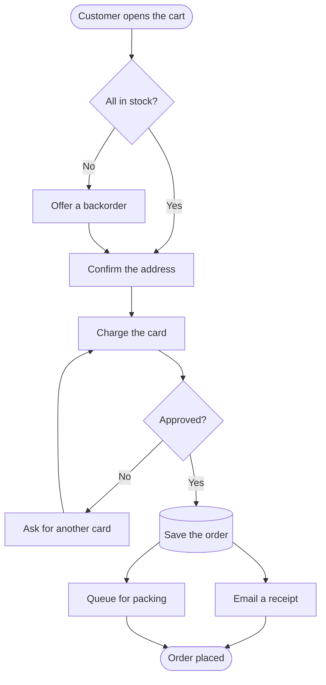
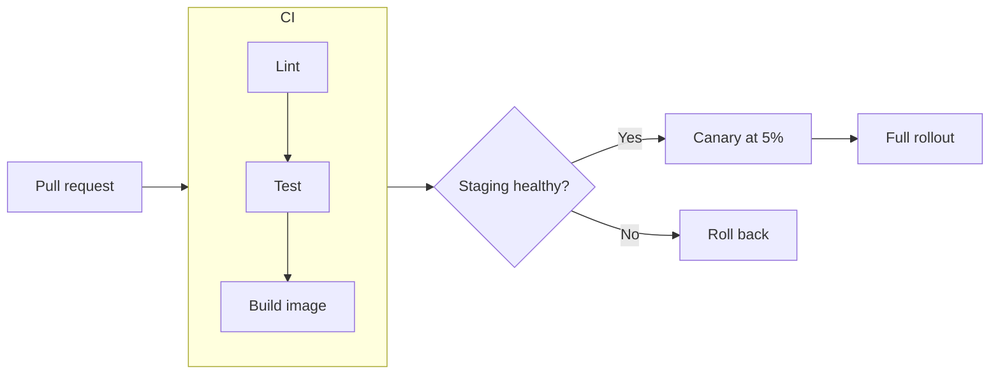
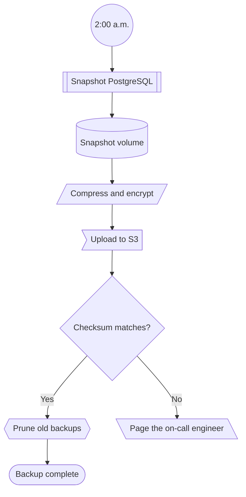
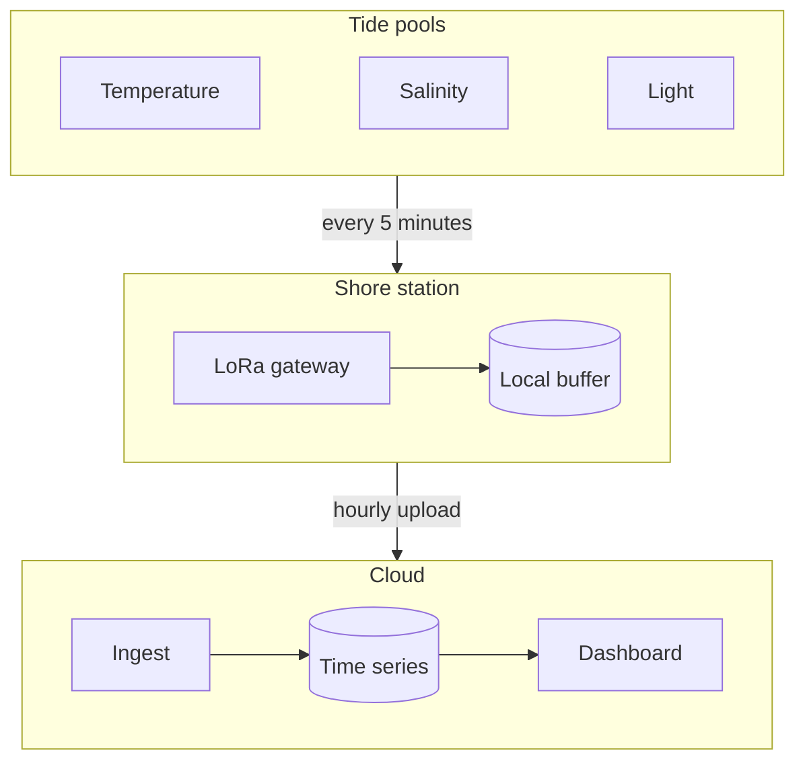
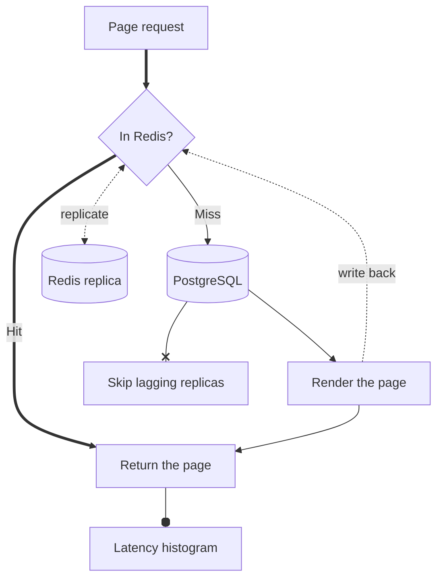
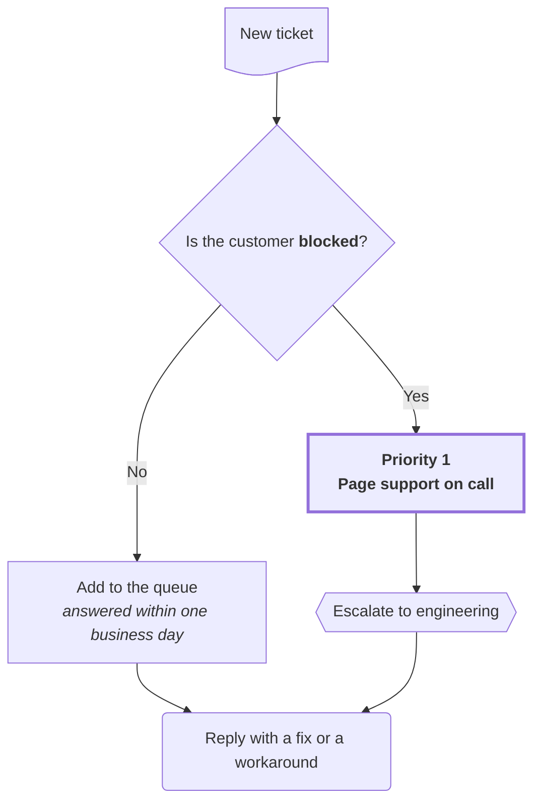

## Checking out an order

## From pull request to production

## Shapes in a nightly backup

## Subgraphs in a tide pool sensor network

## Edge styles in a cache lookup

## Markdown labels in support triage

