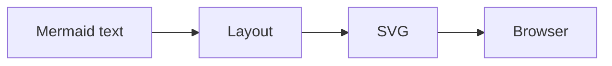
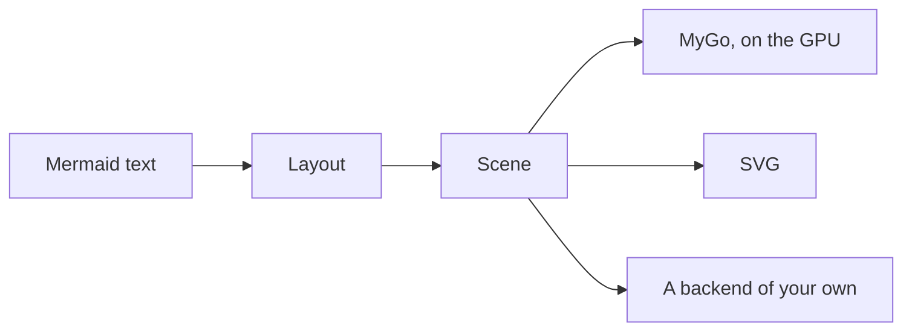

This page is the short form of [limu's design](https://github.com/firede/limu/blob/main/docs/design.md), for those who use it; the design has the details, for those who work on it.

## Where the pipeline branches

A renderer of SVG, as Mermaid and Pele are, lays a diagram out and writes it as SVG, for a browser to draw:

limu stops one step short, at the scene, and branches there, to a backend:

The SVG a renderer writes is all a host gets, and a host that does not draw SVG, as a native app, has nothing to draw. The scene is the diagram laid out as data, before anything is drawn: a host draws it with the tools it has, and can ask it which part is where.

## The stages

A diagram goes through three stages, each a package of its own:

1. **Parsing** reads the diagram's text into a model of it: its front matter and directives, its type, and then its body, with the parser of its type.
2. **Layout** places the model's parts, measuring text with a measurer the host gives, into a scene: what each part is and where it is, but not how it looks.
3. **A backend** draws the scene, settling its colors from a look: the svg package writes SVG, and limumygo draws with MyGo.

| Package | What it does |
| --- | --- |
| `limu` | Parses a diagram's text and lays it out. |
| `diagram` | Reads what every diagram shares, its front matter, directives and type; a package for each type under it parses the type and lays it out. |
| `text` | Measures text, through a measurer the host gives, and lays out labels: lines, wrapping, emphasis, icons. |
| `layout` | The options of layout. |
| `scene` | A diagram laid out. |
| `style` | How a scene looks: themes, and overrides by role. |
| `svg` | Draws a scene as SVG. |
| `limumygo` | Draws a scene with MyGo, in a module of its own. |

All but limumygo import only Go's standard library.

## Layout and style

What changes where things are, or how large they are, belongs to layout, and a change of it lays a diagram out again: the measurer and its fonts, the size of text, the width the host has, the padding about a diagram, a grid to snap to, how edges are routed, and the present for a gantt chart. Everything else is style, settled only when a scene is drawn, and a change of it only draws the scene again.

So a scene holds no colors. Each part names the colors it takes by token, as `Surface` or `Border`, and says what it is by its role, as `flowchart.node`; a backend settles them from a theme and the overrides for each role. The same scene is drawn in a light theme and a dark one, or in a look of an app's own, without being laid out again. See [Theming](/theming).

## A backend of one's own

A backend walks a scene's items in order and draws each: its `Parts`, paths of moves, lines and curves, and boxes, each filled and stroked as its `Paint` says, in the colors its style settles to in the look (`style.Look.Resolve`); the markers at an edge's ends (`Marker.Outline`); its picture; and its label, each line's spans set in their faces about its `At`. A backend with a look of its own draws an item from its `Role`, `Shape`, `Box` and `Route` instead. The svg package is such a backend, in about 700 lines, and the [API](/api#the-scene) page says what an item holds.

## Ported from Pele

Most of limu is ported from [Pele](https://pele.run), the Mermaid renderer of the Obsidian team, function for function, keeping Pele's names where Go allows, so the two can be read side by side. limu follows Pele 1.6.0.

Its tests compare what limu does with what Pele does, number for number. A program, the oracle, runs Pele's own TypeScript sources with Node over cases from Pele's tests and documents and changes made to them, more than a hundred thousand diagrams in all, and writes what Pele makes of each as fixtures; limu's tests compare with the fixtures, and a difference in the last bit of a number is a difference in the port. They run on amd64 and arm64.

To match Pele to the last bit, the port keeps JavaScript's meaning wherever it reaches what is measured or placed: strings counted in UTF-16 code units, JavaScript's white space and case, `Math.round`'s halves, V8's trigonometry, JSON read as V8 reads it, and products kept apart from the sums they are in, where Go would fuse them into one rounding. Text is measured as Pele measures it with no font at hand, by a table of Arial's advances.

Matching Pele is how the port is checked, not what limu is for. Where Mermaid hands a diagram to a library, Pele often lays it out in a way of its own, and limu follows Pele: see [Compatibility](/compatibility).
