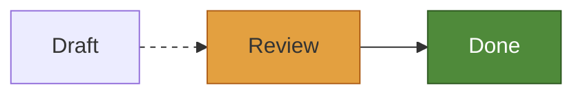

A scene holds no colors: each part names the colors it takes by token, as `Surface` or `Border`, and a backend settles them when it draws. So a change of style only draws a diagram again, without laying it out.

Style comes at three levels, from the least a host does to the most:

1. A **theme**: a handful of colors and measures that every diagram is drawn from.
2. **Overrides**: a style for each role of the parts of diagrams, as `flowchart.node`, that sets some of what the theme gives.
3. **Drawing of one's own**: a function that draws a part in place of the backend's default.

A `style.Look` holds the first two, and is what a backend is given:

```go
look := style.Look{
	Theme: style.KohuDark(),
	Overrides: style.Overrides{
		"flowchart.node": {Fill: style.Accent, Text: style.Bg},
		"flowchart.edge": {Dash: style.Dashes(3, 4)},
	},
}
out := svg.Render(sc, &svg.Options{Look: look})
```

What changes where things are, as the font and the size of text, is not style: it is given to [layout](/api#layout).

## Themes

limu has three themes. `style.Kohu()` and `style.KohuDark()` are limu's own, a light and a dark one, in the colors of this site; `style.Default()` is Pele's light theme, and what a look with no theme takes.

| Token | Used for | `Kohu` | `KohuDark` | `Default` |
| --- | --- | --- | --- | --- |
| `Bg` | Behind the diagram, and behind labels on lines | `#f1f6f5` | `#0c1618` | `#ffffff` |
| `Fg` | Text | `#0f262a` | `#d0dddc` | `#1f1f1f` |
| `Muted` | Secondary text, as the titles of groups | `#536f72` | `#7f989b` | `#6e6e6e` |
| `Line` | Edges and other lines | `#23393d` | `#b4c7c7` | `#1f1f1f` |
| `Surface` | The inside of shapes | `#e5eeec` | `#142428` | `#f3f3f3` |
| `SurfaceAlt` | The inside of groups, and of shapes set apart | `#d6e4e2` | `#1b2f34` | `#e6e6e6` |
| `Border` | The outlines of shapes | `#76939a` | `#557176` | `#8a8a8a` |
| `Accent` | What a diagram marks out | `#a92e4a` | `#ee8494` | `#5b7bd5` |
| `Critical` | What a diagram marks as critical, as a gantt chart's critical tasks | `#b0611a` | `#e3a040` | `#e45756` |

Each theme also has eight series, the colors of a chart's slices, bars and lines, and of a git graph's branches or a mindmap's; a diagram with more than eight takes them again from the first. A part names them as `style.Series(n)`, from `style.Series(0)` for the first.

| Series | `Kohu` | `KohuDark` | `Default` |
| --- | --- | --- | --- |
| 1 | `#4f8a3a` | `#8cbf6a` | `#4c78a8` |
| 2 | `#b5435c` | `#e37d90` | `#f58518` |
| 3 | `#23817d` | `#5cbcb3` | `#54a24b` |
| 4 | `#a8761c` | `#d9a748` | `#e45756` |
| 5 | `#3d6aa3` | `#78a3d9` | `#72b7b2` |
| 6 | `#7b5aa0` | `#ad92d1` | `#eeca3b` |
| 7 | `#c0668a` | `#e693b3` | `#b279a2` |
| 8 | `#7d6a3f` | `#b9a272` | `#9d755d` |

The three themes round the corners of boxes by 4 (`Radius`) and stroke lines 1 wide (`StrokeWidth`).

A theme of one's own is a `style.Theme` with every color set. To change a few colors of a theme, change a copy:

```go
th := *style.Kohu()
th.Accent = style.Hex("#3d6aa3")
look := style.Look{Theme: &th}
```

The svg package writes the theme's colors as CSS variables, so a page can change them, as for its own light and dark themes, without drawing the diagram again. See [SVG](/svg#theme-variables).

## Overrides

`style.Overrides` gives a `style.Style` to a role. What a style leaves unset comes from under it.

| Field | What it sets |
| --- | --- |
| `Fill`, `Stroke`, `Text` | The paints of the inside, of outlines and lines, and of text. |
| `FillOpacity`, `StrokeOpacity`, `Opacity` | The opacities of the fill, of the stroke, and of the whole part. |
| `StrokeWidth` | The width of outlines and lines. |
| `Radius` | The radius of the corners of a box that takes the theme's. |
| `Dash` | The pattern of a line's dashes: `style.Dashes(3, 4)`, or `style.Solid`. |
| `Cap`, `Join` | How a line ends and turns its corners, as SVG's `stroke-linecap` and `stroke-linejoin`. |
| `Halo`, `HaloWidth` | A halo about text, so that lines under it stop short of it. |

A paint is a color of the theme (`style.Surface`, `style.Accent`, `style.Series(2)`…), a color of its own (`style.Of(style.Hex("#3d6aa3"))`), or `style.None`, which draws nothing. `Paint.Alpha` draws one at a part of its opacity. A measure is set with `style.N`, as `StrokeWidth: style.N(2)`.

A part's style is cascaded, from under to over: the theme's measures, the diagram's own style for the part, the overrides for its role, and what the diagram's author set in its text.

### Roles

A role is the name of the diagram's package, a dot, and the part: `flowchart.node`, `sequence.actor`, `pie.slice`. Each diagram's package exports its roles as constants, as `flowchart.RoleNode`, and the svg package writes an item's role as its class, as `limu-flowchart-node`. In the [playground](/playground), the status bar names the role of the part under the pointer.

A swimlane diagram's parts take the roles of a flowchart's, so that an override for `flowchart.node` reaches them too.

## Drawing of one's own

Each backend takes a function that draws an item in place of its default, and may call the default, `next`, for the items it leaves as they are. It is given the default's pieces to draw with: the item's outline, the markers at its ends, its picture and its label. This one draws a flowchart's decisions some other way, and their labels as the default does:

```go
out := svg.Render(sc, &svg.Options{
	Look: look,
	Draw: func(w *svg.Writer, it *scene.Item, s style.Style, next func()) {
		if it.Shape != "diam" {
			next()
			return
		}
		// Write the diamond's markup with w.Raw, in the item's Box.
		w.Label(it, s)
	},
})
```

A backend with a look of its own draws each item from its role, shape, box and, for an edge, its route, and ignores the outline the scene gives. The function belongs to the backend, as each draws with tools of its own: see [SVG](/svg#drawing-of-ones-own) and [MyGo](/mygo#drawing-of-ones-own).

## Styles in the diagram

A diagram's author sets styles in its text, with `classDef`, `class`, `:::` and `style`, and a flowchart's edges with `linkStyle`:



limu reads `fill`, `stroke` and `color`, the opacities, `stroke-width`, `stroke-dasharray`, `stroke-linecap`, `stroke-linejoin`, and `rx` and `ry`; and the weight, the slant and the size of the font, which change the size of text, and so are given to layout. Other properties are left out, as is a value that could reach outside the diagram.

An author's style is laid over the overrides. Its colors are fixed: they do not change with the theme.
