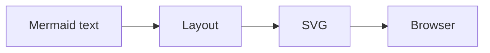
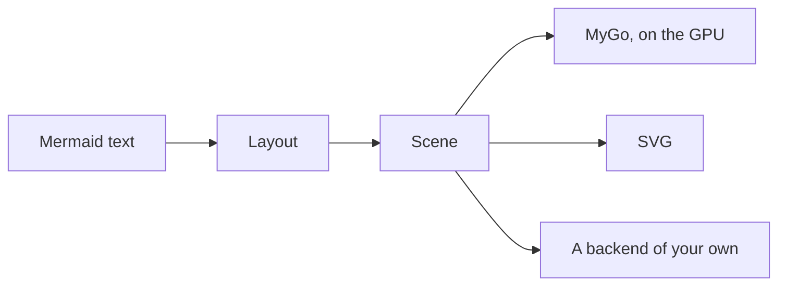

limu reads [Mermaid](https://mermaid.js.org) diagrams and lays them out in Go, for programs that draw them themselves: natively with [MyGo](https://mygo.egoist.dev), as SVG, or in a look of their own.

## How it works

A renderer of SVG, as Mermaid and Pele are, lays a diagram out and writes it as SVG, for a browser to draw:



limu stops one step short, at the scene: the diagram laid out as data, each part, what it is and where it is, but not how it looks. A backend draws the scene: limumygo on the GPU with MyGo's native UI, the svg package as SVG, or one of your own.



As the scene holds no colors, a change of theme only draws it again, without laying it out; and an app can ask it which part is under the pointer.

## limu in your app

### MyGo

```shell
go get github.com/firede/limu/limumygo
```

limumygo draws a scene with MyGo's native UI, on the GPU, and tells which part of it is under the pointer. Lay the diagram out with the fonts it is drawn in.

```go
fonts := limumygo.DefaultFonts
sc, err := limu.Layout(src, &layout.Options{Measurer: fonts})
if err != nil {
	return err
}

// In a view: draw the diagram, and see which part was clicked.
w := limumygo.View(c, sc, &limumygo.Options{
	Look:  style.Look{Theme: style.KohuDark()},
	Fonts: fonts,
})
if it := w.Clicked(); it != nil {
	fmt.Println("clicked", it.Role, it.ID)
}
```

### SVG

```shell
go get github.com/firede/limu
```

The svg package writes a scene as SVG, its colors as CSS variables that a page can set. limu and its svg package need nothing but Go's standard library.

```go
sc, err := limu.Layout(src, nil)
if err != nil {
	return err
}
out := svg.Render(sc, &svg.Options{Look: style.Look{Theme: style.Kohu()}})
```

## Explore

- [Examples](/examples.md): every type of diagram limu reads, in each of its themes.
- [Getting started](/getting-started.md): lay a diagram out, and draw it as SVG or with MyGo.
- [Theming](/theming.md): a theme of colors, overrides by role, and drawing of your own.

## limu and Pele

Most of limu is ported from [Pele](https://pele.run), the small and fast Mermaid renderer of the [Obsidian](https://obsidian.md) team, function for function, and its tests compare what limu lays out with what Pele does, number for number. limu is [open source](https://github.com/firede/limu), under the MIT license.

Pele is named after the goddess of Hawaiʻi's volcanoes; limu is Hawaiian for the algae of its sea, and the colors of this site are those of limu kohu, a red one that grows in its tide pools.
