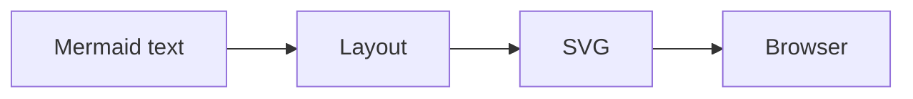
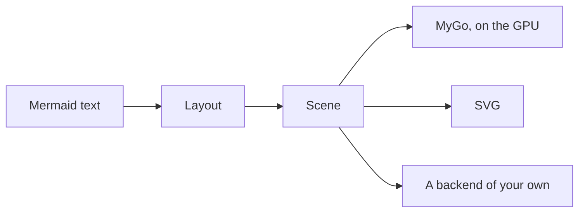

limu is a diagram layout engine in Go. It reads Mermaid and leaves the drawing to your program.

## How it works

Mermaid and Pele lay out a diagram and write it as SVG for a browser to draw.



limu stops one step earlier, at the scene. A scene is the laid-out diagram as data. It says what each part is and where it goes, but not how it looks. A backend then draws it, whether that is limumygo on the GPU, the svg package, or one you write.



Because the scene holds no colors, it's laid out once and can be drawn any number of ways. Switching themes only redraws it, and a backend can also draw each part its own way.


An app can also ask the scene which part is under the pointer.

## limu in your app

### MyGo

```shell
go get github.com/firede/limu/limumygo
```

limumygo draws a scene on the GPU with MyGo's native UI and tells you which part is under the pointer. Lay out the diagram with the same fonts you draw it in.

```go
fonts := limumygo.DefaultFonts
sc, err := limu.Layout(src, &layout.Options{Measurer: fonts})
if err != nil {
	return err
}

// Draw the diagram in a view, and see which part was clicked.
w := limumygo.View(c, sc, &limumygo.Options{
	Look:  style.Look{Theme: style.KohuDark()},
	Fonts: fonts,
})
if it := w.Clicked(); it != nil {
	fmt.Println("clicked", it.Role, it.ID)
}
```

### SVG

```shell
go get github.com/firede/limu
```

The svg package writes a scene as SVG and leaves its colors as CSS variables, so a page can restyle it. limu and the svg package use only Go's standard library.

```go
sc, err := limu.Layout(src, nil)
if err != nil {
	return err
}
out := svg.Render(sc, &svg.Options{Look: style.Look{Theme: style.Kohu()}})
```

## Explore

- [Examples](/examples.md) shows every type of diagram limu supports, in each of its themes.
- [Getting started](/getting-started.md) lays out a first diagram and renders it as SVG.
- [Theming](/theming.md) changes colors with themes and overrides, or draws parts yourself.

## limu and Pele

Most of limu is ported function by function from [Pele](https://pele.run), the small, fast Mermaid renderer made by the [Obsidian](https://obsidian.md) team. limu's tests check that its layouts match Pele's number for number. limu is [open source](https://github.com/firede/limu) under the MIT license.

Pele is named after the goddess of Hawaiʻi's volcanoes. Limu is the Hawaiian word for the algae in its seas, and this site takes its colors from limu kohu, a red alga that grows in tide pools.
